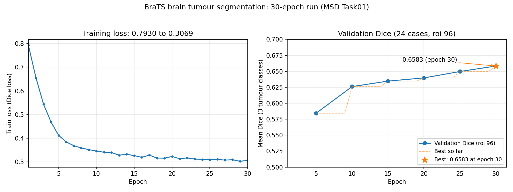

# 3D Brain Tumour Segmentation from Multi-modal MRI with MONAI + UNet

[](https://monai.io/)
[](https://pytorch.org/)
[](http://medicaldecathlon.com/)
[](LICENSE)

An end-to-end project that trains a 3D UNet to segment brain tumours
(gliomas) in multi-modal MRI, built with [MONAI](https://monai.io/) (Medical
Open Network for AI) and PyTorch. It follows MONAI's BraTS segmentation
approach, rewritten as a clean, commented Python project you can read, run,
and extend.

> **Learning project.** I am a radiologic technologist, and I built this to
> learn MONAI and multi-modal MRI segmentation hands-on: how a model reads
> the four MRI sequences of a brain tumour case (FLAIR, T1,
> contrast-enhanced T1, and T2) and turns them into a map of the tumour
> and its sub-regions. Brain MRI is the field I want to work in. This
> follows my [3D spleen segmentation](https://github.com/FaezeHajeb/MONAI-spleen-segmentation)
> project.

## Why brain tumour segmentation?

Gliomas are the most common primary brain tumours, and their treatment (surgery, radiotherapy, chemotherapy) depends on knowing exactly where the
tumour is and how much of it enhances, how much is necrotic core, and how
far the oedema reaches. A radiologist tracing those regions by hand in a
four-sequence MRI takes a long time per case, and two readers rarely draw
exactly the same borders. An automatic segmentation gives a reproducible
measurement in seconds. That is what this project does: given a
multi-modal MRI volume, it produces a 3D mask with four classes
(0 = background, 1 = peritumoural oedema, 2 = necrotic/non-enhancing
tumour core, 3 = enhancing tumour).

## Dataset

| | |
|---|---|
| **Task** | Medical Segmentation Decathlon (MSD), Task01: Brain Tumour |
| **Modality** | Multi-modal MRI: FLAIR, T1, T1ce (contrast-enhanced T1), T2 (in that channel order) |
| **Size** | 750 3D volumes: **484 training** (with expert masks) + **266 test** (no masks) |
| **Source** | BraTS challenge data, packaged by the Decathlon |
| **Format** | NIfTI (`.nii.gz`), 240×240×155 voxels, 1 mm isotropic, skull-stripped |
| **Licence** | [CC BY-SA 4.0](https://creativecommons.org/licenses/by-sa/4.0/) |
| **Download** | [medicaldecathlon.com](http://medicaldecathlon.com/), or the MONAI mirror used by `download_data.py` (no registration needed) |

Labels (MSD convention, verified in the dataset's `dataset.json`):
0 = background, 1 = peritumoural oedema, 2 = necrotic and non-enhancing
tumour core, 3 = enhancing tumour. Note this differs from the original
BraTS labels (1 = necrotic core, 2 = oedema, 4 = enhancing tumour, with
no label 3): the Decathlon remapped them to the continuous 0–3 scheme
above (the same remapping nnU-Net uses), so no relabelling is needed.
Beware older tutorials that describe the MSD labels differently. The
`dataset.json` in the download itself is the authority, and it lists
1 = edema, 2 = non-enhancing tumor, 3 = enhancing tumour.

Split used here: 460 cases for training, 24 cases for validation
(the last 24 cases, sorted by file name).

**Why MSD Task01 and not BraTS 2021 directly?** The full BraTS 2021
training set (1,251 cases) is public, but it needs a Synapse account and
a data-use agreement, and it is far larger. MSD Task01 is the same kind
of data (BraTS cases, four sequences, expert labels) in a single
archive that downloads with one command and no registration. It is the
right starting point; moving to the full BraTS 2021 set later only means
pointing `train.py` at a different folder.

Please cite the datasets as:
Antonelli, M. et al. *The Medical Segmentation Decathlon.* Nature
Communications 13, 4128 (2022), https://arxiv.org/abs/1902.09063
Menze, B. H. et al. *The Multimodal Brain Tumor Image Segmentation
Benchmark (BRATS).* IEEE Transactions on Medical Imaging 34(10),
1993–2024 (2015), https://doi.org/10.1109/TMI.2014.2377694

## Method

- **Model:** 3D UNet: `channels=(16, 32, 64, 128, 256)`, `strides=(2, 2, 2, 2)`,
  `num_res_units=2`, batch normalisation. Four input channels (FLAIR, T1,
  T1ce, T2), four output channels (background / oedema / core /
  enhancing tumour).
- **Preprocessing:** per-channel intensity standardisation (mean 0, standard
  deviation 1 over the brain voxels). MRI has no fixed intensity scale
  like CT's Hounsfield units, so each scan is standardised on its own;
  foreground cropping, RAS orientation, resampling to `1 × 1 × 1 mm`
  voxels, and balanced random `96³` patches (half centred on tumour).
- **Loss:** Dice loss. **Optimiser:** Adam, learning rate `1e-4`.
- **Metric:** mean Dice score (background excluded) on the 24 validation
  cases, averaged over the three tumour classes.
- **Validation:** sliding-window inference (`96³` window), because a whole
  brain volume does not fit in GPU memory at once. The window matches the
  `96³` training patches: a diagnostic on the 10-epoch model showed the
  larger `128³` window understates Dice (mean 0.5672 at roi 128 vs 0.5979
  at roi 96 on 6 validation cases), so validation uses roi 96.
- **Training:** 30 epochs by default (`train.py --epochs`).

A note on how BraTS results are usually reported: the challenge scores
three *regions*: whole tumour (labels 1+2+3), tumour core (labels 2+3),
and enhancing tumour (label 3), rather than the four classes separately.
This project's 4-class mean Dice is therefore not directly comparable to
published BraTS region scores; the reference row below is a rough guide
to what strong models achieve, not a target on the same metric.

## Results

The Dice score measures overlap between the predicted mask and the expert
mask: 0 = no overlap, 1 = perfect overlap. For brain tumours, whole-tumour
Dice above 0.9 is considered excellent; the small enhancing-tumour region
is the hardest and scores lower.

| Run | Validation Dice |
|---|---|
| nnU-Net (default), BraTS 2021 validation set, region Dice (Wang et al. 2021, arXiv:2110.07919) | WT **0.925**, TC **0.878**, ET **0.815** |
| **My run: 30 epochs, 460 train / 24 validation cases, roi 96** | **Best mean Dice 0.6583 at epoch 30** |

> The nnU-Net figures are published results on the BraTS 2021 validation
> set, not results of this repo, and they are region Dice, not the
> 4-class mean Dice this project reports. They are a rough guide to what
> strong models achieve, not a target on the same metric.

### The 30-epoch run

Trained on Google Colab (free Tesla T4 GPU) in November 2026. The run was
cut off by a Colab disconnect after epoch 16 and resumed from the
epoch-15 best checkpoint with `--resume` and `--start-epoch 16`, then
completed epochs 17-30. Train loss fell from 0.7930 (epoch 1) to 0.3069
(epoch 30). Validation Dice (mean over the three tumour classes,
background excluded, 24 validation cases, roi 96) improved at every
validation point:

| Epoch | 5 | 10 | 15 | 20 | 25 | 30 |
|---|---|---|---|---|---|---|
| Validation Dice | 0.5844 | 0.6261 | 0.6347 | 0.6397 | 0.6497 | **0.6583** |

An earlier 10-epoch run reached a best validation Dice of 0.5862 (at
roi 128); the diagnostic that followed showed roi 96 scores higher than
roi 128, so the 30-epoch run validates at roi 96 throughout.



### Segmentation overlays

`brats-visualize.py` runs the trained model over all 24 validation cases
and saves a 3-panel axial figure (FLAIR input, ground-truth overlay,
prediction overlay) for the best, median and worst cases by Dice, in the
run folder under `figures/` (`overlay_best_<case>.png`,
`overlay_median_<case>.png`, `overlay_worst_<case>.png`), with a JSON
summary of the per-case scores (`brats_visualization.json`).

## Quickstart

### Option A: Google Colab (free GPU, recommended)

```python
# 1. In Colab: Runtime -> Change runtime type -> T4 GPU
# 2. Clone the repo and install (one cell):
!git clone https://github.com/FaezeHajeb/brats-brain-segmentation.git
%cd brats-brain-segmentation
!pip install -r requirements.txt

# 3. Download the data (~5.7 GB):
!python download_data.py

# 4. Smoke test (1 epoch, 2 cases - proves everything works):
!python train.py --quick

# 5. Real training (about 3-4 hours on a free T4 GPU):
!python train.py --data-dir data/Task01_BrainTumour --output-dir runs/brats_unet

# 5b. If Colab cuts the run off (free runtimes disconnect), resume it from
# the best checkpoint instead of starting over. Example: cut off after
# epoch 16, best model from epoch 15:
!python train.py --data-dir data/Task01_BrainTumour --output-dir runs/brats_unet \
    --resume runs/brats_unet/best_model.pth --start-epoch 16
# This continues with epochs 17-30, appends to the existing metrics.csv,
# and only replaces best_model.pth if a later epoch beats it.

# 6. Visualise the result: overlay figures for the best, median and
# worst validation cases (saved to the run folder under figures/):
!python brats-visualize.py \
    --checkpoint /content/drive/MyDrive/brats_unet/run30ep/best_model.pth \
    --data-dir data/Task01_BrainTumour \
    --output-dir /content/drive/MyDrive/brats_unet/run30ep/figures
```

### Option B: Local machine (needs a GPU for real training)

```bash
git clone https://github.com/FaezeHajeb/brats-brain-segmentation.git
cd brats-brain-segmentation
python -m venv .venv && source .venv/bin/activate   # Windows: .venv\Scripts\activate
pip install -r requirements.txt
python download_data.py
python train.py --quick          # smoke test
python train.py                  # full training (30 epochs)
```

### Segment a new MRI volume

```bash
python predict.py --checkpoint runs/brats_unet/best_model.pth \
    --input data/Task01_BrainTumour/imagesTr/BRATS_001.nii.gz
# -> outputs/BRATS_001_seg.nii.gz  (0-3, see the labels in Dataset above)
```

Open the input MRI and the `_seg.nii.gz` mask together in
[3D Slicer](https://www.slicer.org/) or ITK-SNAP to see the result.

## Repository structure

```
brats-brain-segmentation/
├── train.py            # training script (UNet + Dice loss + validation)
├── predict.py          # inference: segment an MRI volume, save the mask
├── brats-visualize.py  # overlay figures for the best/median/worst val cases
├── download_data.py    # downloads MSD Task01 Brain Tumour (~5.7 GB)
├── training-curves.png # train loss + validation Dice over the 30-epoch run
├── requirements.txt    # pinned versions (MONAI 1.6.0, PyTorch 2.8.0, ...)
├── README.md           # this file
├── .gitignore          # keeps data/, runs/ and checkpoints out of git
├── data/               # dataset (downloaded, not committed)
├── runs/               # checkpoints + metrics.csv + TensorBoard logs
└── outputs/            # predicted masks
```

## What I learned

- Loading and preprocessing multi-channel 3D MRI with MONAI transforms
  (`LoadImaged`, `NormalizeIntensityd`, `Spacingd`,
  `RandCropByPosNegLabeld`).
- Why MRI needs per-scan intensity standardisation, while CT uses a fixed
  Hounsfield-unit window.
- Why Dice loss (not accuracy) is the right objective when the tumour is
  a small part of the volume.
- Sliding-window inference for volumes that do not fit in GPU memory.
- Why the validation window must match the training patch size: a
  diagnostic showed roi 128 understates Dice compared with roi 96.
- Resuming an interrupted run from the best checkpoint instead of
  starting over, with metrics appended to the existing log.
- The full loop: data → model → metric → checkpoint → inference → visual
  check in 3D Slicer.

## Licence

Code in this repository is released under the MIT licence. The MSD Brain
Tumour dataset is released under CC BY-SA 4.0. Please respect its licence
and cite the Decathlon and BraTS papers (see *Dataset* above) if you use it.
